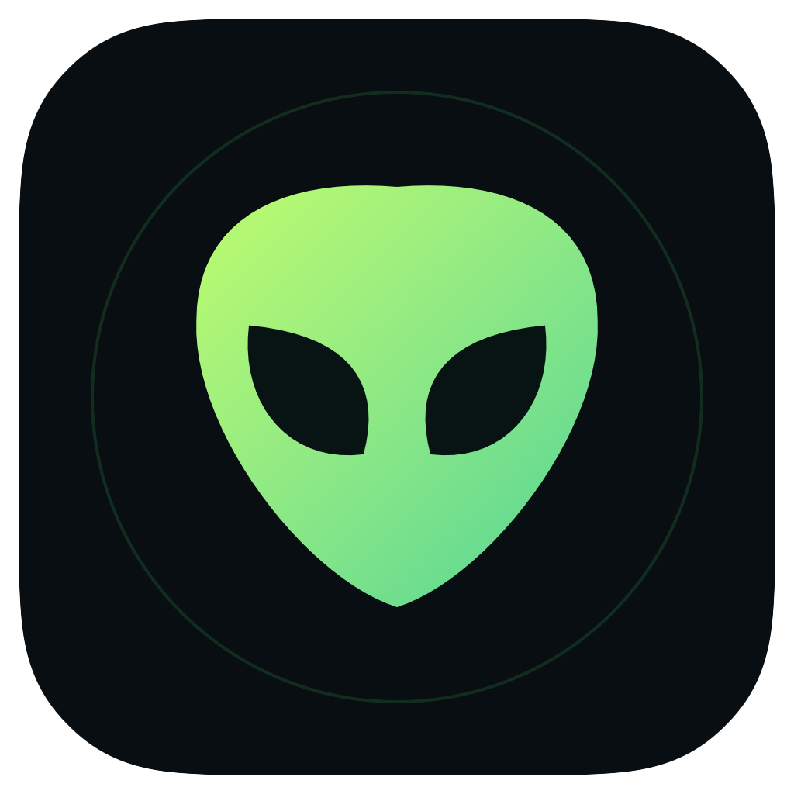

<p align="center">
  
</p>

# Syndrome™

**By: Premise LLC's Disinformation Labs™**

An offline macOS sound studio and educational DSP app. Explore waveforms, hear local speech and modulated carriers, and place a virtual audio source inside a modeled room. Built with SwiftUI, Accelerate/vDSP and AVFoundation.

[Download for macOS](https://github.com/Rali0s/Syndrome-TM/releases/latest) · [Installation guide](docs/INSTALL_MACOS.md) · [DSP & spatial models](docs/DSP_AND_SPATIAL_MODELS.md) · [Apache 2.0 license](LICENSE)

## Download

The [v1.7.1 release](https://github.com/Rali0s/Syndrome-TM/releases/tag/v1.7.1) includes:

| File | Use |
| --- | --- |
| `Syndrome-1.7.1-macOS-universal.dmg` | Open, then drag Syndrome.app to Applications |
| `Syndrome-1.7.1-macOS-universal.zip` | Extract, then copy Syndrome.app to Applications |
| `SHA256SUMS.txt` | Verify either download |

**Requirements:** macOS 14 Sonoma or later; Apple silicon or Intel. Both architectures are included. No Xcode is needed to run the download. Speech generation needs an installed macOS voice.

**Distribution status:** ad-hoc signed, not Apple-notarized. A downloaded copy may be blocked by Gatekeeper. See [first-launch instructions](docs/INSTALL_MACOS.md#signing-and-first-launch). Runtime verification was performed on Apple silicon / macOS 26.3; Intel and macOS 14 are build targets that have not been runtime-tested.

## First session

1. Open Syndrome. Audio starts **off**.
2. In **Sound Board**, choose a pad; or in **SubVocal Speech**, type a phrase and press **Generate preview**.
3. Enable **Audio** and press a **Play** button. The master level controls all previews.
4. For words, choose **Clear words + carrier**. For a tone following speech cadence and intonation, choose **Carrier only**.
5. In **Room + apparition**, press **Place in room**, play a preview and drag the figure. Its head marker is the virtual voice origin.
6. Use **Stop audio** to end playback. **Pause** freezes the visual cursor and an active throw while audio continues at the held position.

Room placement, rotation, distance and master controls are shared between Sound Board and SubVocal. Changing sections or leaving the app stops audio. Selecting a sound, generating speech, or dragging a figure never starts playback automatically.

## Features

| View / control | What it does |
| --- | --- |
| Sound Board | Pure master tone, orbital chime, twin-tone beats and a frequency sweep, with time and spectrum plots |
| SubVocal Speech | Local text-to-speech, ordinary voice comparison, clear-words mix, cadence-only or cadence-and-intonation carrier |
| Clear words | Gentle articulation lift and adjustable carrier underlay; retains the actual speech sample rate and timing |
| Master frequency | 0.50–2,000 Hz, exact entry, logarithmic slider and presets; controls the carrier, pure pad and Range tone |
| Virtual room | Synthetic point cloud, editable room dimensions and a movable apparition; no lidar scan required or captured |
| Orientation | Yaw, pitch, roll, Face listener and optional directional voice gain |
| Spatial sphere | X/Y/Z plane maps, exact coordinates, inner balance radius, distance gain and six finite axis throws |
| Range | Explicit free-field attenuation and travel-time assumptions, with reference/received comparisons |
| Waveforms | Synthetic sine and its correctly scaled one-sided spectrum |
| Modulation | Original, AM and SSB comparisons; spectrum translation versus bandwidth reduction |
| Beats | Linear tone sums and envelopes versus difference-frequency components from an explicit nonlinear model |
| Recording | High-pass filtering, sampling/aliasing, FFT duration and window-function simulations |
| Bluetooth Prep | Local preparation fields only; Scan, Pair and Connect remain disabled |

The original alien logo, apparition and visualizations are drawn in native code. Attribution appears at the bottom left of the application.

## What the simulations mean

- Carrier-only output preserves an amplitude envelope and estimated intonation. It does **not** preserve intelligible words. Clear words adds real, ordinary-band speech; it does not confine speech below 20 Hz.
- X/Y/Z describe a virtual source relative to a fixed listener. macOS HRTF processing supplies headphone cues, with a labeled stereo-pan fallback when needed. Ordinary speakers are not assumed to place audio at that physical point.
- Room walls are visual guides. No room reflections, occlusion, acoustic calibration, beam steering or real-world tracking are inferred.
- Distance gain stays at 1 inside radius R and follows R/r outside it. Directional voice optionally adds a broad facing gain. Neither is a measured sound-pressure level.
- FFT plots and recording lessons use synthetic data and explicit assumptions; they assert no universal microphone or codec behavior.

See [DSP & spatial models](docs/DSP_AND_SPATIAL_MODELS.md) for equations, sample-rate conventions, pitch tracking, window scaling and model limits.

## Privacy and offline behavior

The app makes no network requests and does not implement microphone capture, camera/lidar capture, haptics, Bluetooth discovery/pairing, head tracking, hidden-signal detection or background monitoring. Audio uses the output already selected in macOS. Bluetooth may already be your system output; Syndrome does not connect devices.

Speech is generated locally into memory using an installed voice. The app does not save typed phrases or generated audio to disk. Master frequency and Bluetooth preparation preferences are stored locally. Other studio and room controls are session state. Installing system voices, downloading the release and cloning the repository are separate online operations.

## Build without the Xcode app

Install Apple's Command Line Tools if needed:

```sh
xcode-select --install
```

Clone and build:

```sh
git clone https://github.com/Rali0s/Syndrome-TM.git
cd Syndrome-TM
./scripts/test.sh
./scripts/build-app.sh
open dist/Syndrome.app
```

The package declares Swift tools 5.9 and macOS 14 as minimums. This release was built using Swift 6.3.1 and the installed macOS SDK. `build-app.sh` builds for the current Mac's architecture, bundles the icon/license/notices, and applies an ad-hoc signature. `swift run Syndrome` launches a development build.

## Build in Xcode

Open `Syndrome.xcodeproj`, select the **Syndrome** scheme and **My Mac**, then Run. The project uses the same source files as the command-line build and local ad-hoc signing. A developer account is not needed for that local configuration.

The scheme does not contain XCTest tests: the deterministic tests are the standalone `SyndromeChecks` executable. Full Xcode IDE builds were not run for this release; SwiftPM, direct compiler builds and project-plist validation were performed.

## Test

```sh
./scripts/test.sh          # 711 deterministic DSP and geometry checks; no playback
./scripts/test-spatial.sh  # Native spatial graph rendered offline; no speaker output
./scripts/test-speech.sh   # Installed voice + working audio device; output volume stays zero
```

Tests cover frequency axes, FFT peaks, filters, AM/SSB, beats, aliasing, pitch and envelope mapping, clear-speech headroom, spatial projections, eight octants, all six throws, Euler rotation, room geometry, distance/facing gain and playback lifecycle. They verify signal and software behavior, not human intelligibility or calibrated acoustics.

## Package a release

```sh
./scripts/test.sh
./scripts/test-spatial.sh
./scripts/test-speech.sh
./scripts/package-release.sh
```

`package-release.sh` uses the Command Line Tools to compile arm64 and x86_64 for macOS 14, combines them into a universal binary, checks both architectures and the app signature, and creates ZIP/DMG assets with SHA-256 checksums under `dist/releases/v1.7.1/`. LICENSE, NOTICE, installation instructions and release notes accompany the app. It does not upload, notarize, or use signing credentials.

The version comes from `Resources/Info.plist`; the matching notes live in `releases/vVERSION.md`. Download artifacts are attached to GitHub Releases rather than committed to Git.

## Repository layout

```text
Sources/Syndrome/       SwiftUI app, audio playback, room and plot views
Sources/SyndromeDSP/    Deterministic DSP and spatial models
Sources/SyndromeChecks/ Standalone deterministic checks
Resources/             App metadata and icon
Syndrome.xcodeproj/     Native Xcode project and shared scheme
scripts/               Build, packaging, icon rendering and integration checks
docs/                  Installation and model documentation
releases/              Versioned release notes
LICENSE / NOTICE       Apache 2.0 terms and attribution
```

## Contributing

See [CONTRIBUTING.md](CONTRIBUTING.md). Report reproducible issues through [GitHub Issues](https://github.com/Rali0s/Syndrome-TM/issues). Include the app version, macOS version, processor type and steps to reproduce; omit private phrases or recordings unless you intend to share them.

## License and attribution

Copyright 2026 Premise LLC. **By: Premise LLC's Disinformation Labs™.**

Source code, documentation and original project artwork are licensed under the [Apache License, Version 2.0](LICENSE). See [NOTICE](NOTICE). The license's trademark provisions apply to the Syndrome™ and Disinformation Labs™ names; attribution does not imply endorsement of modified versions. Apple frameworks and installed system voices retain their own terms and are not included as redistributable source assets.
